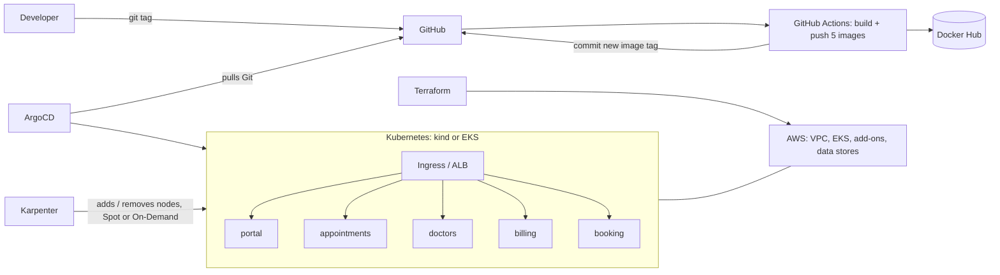

# CareConnect DevOps Portfolio

An end-to-end **DevOps / platform engineering project**: a clinic appointment platform (**CareConnect**) with five microservices, containerised, deployed to Kubernetes with Helm, delivered through a **GitOps pipeline**, and backed by **Terraform** for the AWS network, EKS cluster and data services.

> The services are intentionally minimal (each answers on `/health` and reports which container served the request). **The platform around them is the project.**

**Run it:** [RUN-IT.md](RUN-IT.md) (step by step, with what to expect and what to remember)  ·  **Go deeper:** [LABS.md](LABS.md) (guided labs for each course section)  ·  **Show it:** [SHOW-IT.md](SHOW-IT.md) (6-minute demo script, concepts)  ·  **Prepare:** [INTERVIEW-QA.md](INTERVIEW-QA.md) (questions and short answers)  ·  **Checklist:** [COURSE-MAP.md](COURSE-MAP.md) (every course topic and where it lives)

## What it demonstrates

- **Containers:** multi-stage, non-root, health-checked images for Java, Go and Node.js; multi-architecture builds (Intel and ARM)
- **Local environment:** Docker Compose with separate networks, health checks, startup ordering, one-shot migration job, scaling, profiles, links and aliases
- **Kubernetes:** pods, deployments, services, ConfigMaps, Secrets, StatefulSets with persistent storage, Ingress, autoscaling (HPA), probes, resource limits
- **Helm:** one reusable chart for all services, values per service and environment
- **GitOps and CI/CD:** GitHub Actions builds and publishes images on a version tag, commits the new version to Git, and ArgoCD deploys it. Rollback is a `git revert`
- **Infrastructure as code:** Terraform for the VPC (reusable module, tfvars, remote state), an EKS cluster with IAM roles and add-ons, the AWS data plane (DynamoDB, SQS, RDS, ElastiCache), plus DNS/TLS as a documented extra
- **Node autoscaling with Karpenter:** installed with Terraform (IAM, SQS, EventBridge), On-Demand and Spot NodePools, right-sizing, consolidation, diversification, and Spot interruption handling with a PodDisruptionBudget (4 demos in [RUN-IT.md](RUN-IT.md), Steps 22 to 25)
- **Security habits:** no secrets in Git, least-privilege IAM roles, Pod Identity instead of access keys, OIDC option for CI
- **Observability:** an OpenTelemetry pipeline (traces, metrics, logs), with a free local lab and an AWS (X-Ray, Prometheus) version

## The application

| Service | Language | Data store |
|---|---|---|
| `portal` | Java (Spring Boot) | none |
| `appointments` | Java (Spring Boot) | DynamoDB |
| `doctors` | Go | MySQL / MariaDB |
| `billing` | Java (Spring Boot) | PostgreSQL + SQS |
| `booking` | Node.js | Redis + SQS |

## Architecture

## Repository layout

| Folder | What is in it |
|---|---|
| `apps/` | The five services, each with its own Dockerfile |
| `compose/` | The local Docker Compose stack and gateway |
| `docker/` | Multi-architecture Dockerfile, a Dockerfile with every instruction, layer-caching and BuildKit examples |
| `kubernetes/` | Local cluster config, datastores, and example manifests (basics, secrets, storage, ingress, HPA) |
| `charts/` | The Helm chart used by every service |
| `gitops/` | ArgoCD setup and per-service, per-environment values (this is what CI edits) |
| `terraform/` | VPC module and examples, EKS cluster, add-ons, data plane, CI OIDC role, DNS/TLS |
| `karpenter/` | Pod-driven node autoscaling: Terraform install, On-Demand and Spot NodePools, interruption handling (see its [README](karpenter/README.md)) |
| `observability/` | OpenTelemetry on EKS, and a free local lab |
| `.github/workflows/` | PR checks and the release pipeline |
| `ci/` | The ECR + OIDC release workflow (the course version) |

## Screenshots
Add yours to `docs/screenshots/` (file names are in [that folder's README](docs/screenshots/README.md)), then show the best four to six here:

<!--  -->
<!--  -->
<!--  -->
<!--  -->

## Problems I hit and what I learned
_Write 3 to 5 real points after you run it: something that broke, how you found the cause, what you changed. These are the most valuable lines in this repository._

## Honest notes
- Steps that use real AWS cost money while running and are marked optional in [RUN-IT.md](RUN-IT.md). Destroy them the same day.
- Karpenter, DNS/TLS and the AWS observability stack need real AWS. Mark each one here as "run" or "documented only", whichever is true:
  - Karpenter (RUN-IT Steps 22 to 25): _run / documented only_
  - DNS/TLS: _run / documented only_
  - AWS observability: _run / documented only_
- The Spot interruption demo uses a **simulated** warning message sent to the queue, not a real AWS reclaim.
- The checklist at the bottom of [COURSE-MAP.md](COURSE-MAP.md) is where you record, truthfully, which parts you actually ran. Copy the true lines into this README before you share it.
