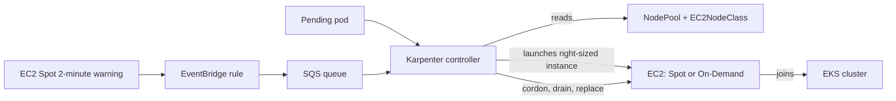

# Karpenter: pod-driven node autoscaling

HPA adds **pods**. Karpenter adds **nodes**: when a pod cannot be scheduled, Karpenter launches the cheapest EC2 instance that fits it, and removes nodes that are empty or underused. Step-by-step instructions are in [RUN-IT.md](../RUN-IT.md), **Steps 22 to 25** (needs the EKS cluster from Steps 20 and 21).

## The four demos

| Demo | RUN-IT step | What you show | Files |
|---|---|---|---|
| 1. Install with Terraform | 22 | Controller, IAM roles, SQS queue, EventBridge rules | `main.tf`, `variables.tf`, `outputs.tf`, `versions.tf` |
| 2. On-Demand instances | 23 | NodePool + EC2NodeClass, right-sizing, consolidation | `manifests/ec2nodeclass.yaml`, `manifests/nodepool-ondemand.yaml`, `manifests/inflate.yaml` |
| 3. Spot instances | 24 | Spot NodePool, diversification, cost saving | `manifests/nodepool-spot.yaml` |
| 4. Spot interruption handling | 25 | 2-minute warning, drain, reschedule, PodDisruptionBudget | `manifests/spot-workload-pdb.yaml` |

## How it fits together

## Concepts to remember

| Concept | Remember |
|---|---|
| NodePool | The rules: instance types, Spot or On-Demand, CPU cap (`limits`), expiry, consolidation |
| EC2NodeClass | The AWS details: AMI, subnets, security group, disk, node role |
| Right-sizing | Karpenter picks the instance from the pods' resource **requests** |
| Consolidation | Empty or underused nodes are removed and pods repacked (`WhenEmptyOrUnderutilized`) |
| Spot | Spare capacity, often around 70% cheaper, reclaimed with a 2-minute warning |
| Diversification | Allow many instance categories, sizes and zones |
| `weight` | Higher weight is tried first: Spot (50) before On-Demand (10) |
| Interruption queue | `settings.interruptionQueue` in `main.tf` is what turns Spot handling on |
| PodDisruptionBudget | Keeps enough replicas serving while a node is drained |
| Why a managed node group too | Karpenter cannot run on a node it has to create itself |

## Safety and cost
- Each NodePool is capped at `limits.cpu: "8"`.
- Run **Step 26** (teardown) the same day. Delete the NodePools first so Karpenter removes its own instances.
- The interruption demo sends a **simulated** warning to the queue. The official way to trigger a real one is AWS Fault Injection Service.

## Before production
Two controller replicas, a pinned AMI version instead of `al2023@latest`, an On-Demand fallback for critical workloads, and node expiry that matches your patching schedule.
